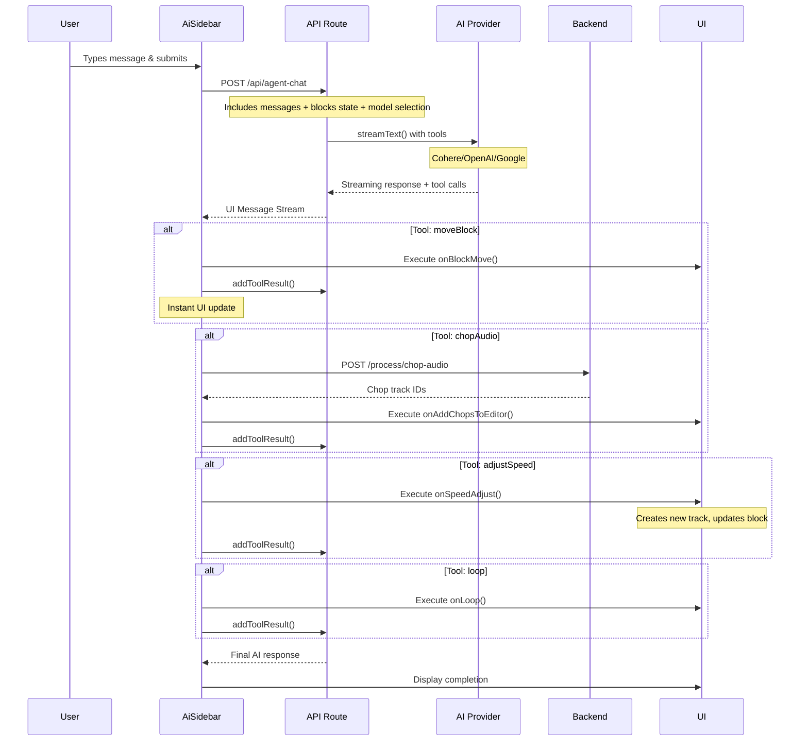

# Agent System Flow Documentation

## Overview

The Lavoe Agent is an AI-powered music composition assistant that can manipulate music blocks in real-time through natural language commands. The system uses a streaming architecture with client-side tool execution for immediate UI updates.

## Architecture Diagram



## Detailed Flow Breakdown

### 1. User Input (Frontend)

**File**: `frontend/components/beat/AiSidebar.tsx:598-622`

When a user types a message and submits:

```typescript
const handleFormSubmit = (e: React.FormEvent) => {
  e.preventDefault();
  if (mode === "agent") {
    if (agentInput.trim()) {
      sendMessage(
        {
          text: agentInput,
        },
        {
          body: {
            blocks: blocks.toSorted((a, b) => a.startTime - b.startTime),
            model: aiModel, // "command-A-03", "gpt-4o-mini", or "gemini-2.5-flash"
          },
        }
      );
      setAgentInput("");
      onSubmit("agent"); // Notify parent
    }
  }
};
```

**Key Points**:
- Uses `@ai-sdk/react`'s `useChat` hook for streaming
- Sends current blocks state with every message for context
- User can select AI model (Cohere Command A-03, GPT-4o-mini, or Gemini 2.5 Flash)
- Input is cleared immediately for responsive UX

---

### 2. API Route Processing (Next.js API)

**File**: `frontend/app/api/agent-chat/route.ts:92-206`

The API route receives the request and sets up streaming:

```typescript
export async function POST(req: NextRequest) {
  const body = await req.json();
  const { messages, blocks, model = "gpt-4o-mini" } = body;

  // Build context from current blocks
  const blocksContext = blocks && blocks.length > 0
    ? `Current blocks in the timeline:\n${blocks.map(block =>
        `- Block "${block.name}" (ID: ${block.id}) at time ${block.startTime} measures...`
      ).join('\n')}`
    : "No blocks currently in the timeline.";

  // Select AI provider
  let selectedModel;
  switch (model) {
    case "gemini-2.5-flash":
      selectedModel = google("gemini-2.5-flash");
      break;
    case "command-A-03":
      selectedModel = cohere("command-a-03-2025");
      break;
    case "gpt-4o-mini":
    default:
      selectedModel = openai("gpt-4o-mini");
      break;
  }

  // Stream response with tools
  const result = await streamText({
    model: selectedModel,
    messages: convertToModelMessages(messages),
    tools: { moveBlock, chopAudio, adjustSpeed, loop },
    system: `You are Lavoe Agent...${blocksContext}...`
  });

  return result.toUIMessageStreamResponse();
}
```

**Key Points**:
- Converts blocks state into natural language context for the AI
- Supports 3 AI providers through the AI SDK
- Defines 4 tools (client-side execution, no server-side execute functions)
- Returns streaming response for real-time updates

---

### 3. Tool Definitions (API Route)

**File**: `frontend/app/api/agent-chat/route.ts:9-90`

#### 3.1 Move Block Tool

```typescript
const moveBlock = tool({
  description: "Move a music block to a new start time in the timeline...",
  inputSchema: z.object({
    blockId: z.string().describe("The ID of the block to move"),
    newStartTime: z.number().min(0).describe("New start time in measures"),
  }),
  // No execute function - handled client-side
});
```

#### 3.2 Chop Audio Tool

```typescript
const chopAudio = tool({
  description: "Chop an audio track into segments based on onset detection...",
  inputSchema: z.object({
    trackId: z.string().describe("The ID of the track to chop"),
    defaultLength: z.number().min(0.1).max(10).default(1.8),
    minDuration: z.number().min(0.05).max(2).default(0.2),
    nClusters: z.number().min(1).max(20).default(3),
    maxChops: z.number().min(1).max(50).default(6),
  }),
  // No execute function - handled client-side
});
```

#### 3.3 Adjust Speed Tool

```typescript
const adjustSpeed = tool({
  description: "Adjust the speed of an audio block...",
  inputSchema: z.object({
    blockId: z.string().describe("Block ID to speed adjust"),
    speedFactor: z.number().min(0.1).max(10).describe("Speed factor (1.0 = normal)"),
  }),
});
```

#### 3.4 Loop Tool

```typescript
const loop = tool({
  description: "Loop/duplicate a music block multiple times...",
  inputSchema: z.object({
    blockId: z.string().describe("Block ID to loop"),
    times: z.number().min(1).max(10).describe("Number of loops"),
  }),
});
```

**Key Points**:
- Tools have no `execute` function - they're metadata for the AI
- Client-side execution provides instant UI feedback
- Zod schemas ensure type safety and validation

---

### 4. Tool Call Handling (Frontend)

**File**: `frontend/components/beat/AiSidebar.tsx:360-445`

When the AI calls a tool, the frontend intercepts and executes:

```typescript
const { messages, sendMessage, status, error, addToolResult } = useChat({
  transport: new DefaultChatTransport({ api: "/api/agent-chat" }),

  onToolCall: ({ toolCall }) => {
    // Skip dynamic tools
    if (toolCall.dynamic) return;

    // Handle each tool type...
    if (toolCall.toolName === "moveBlock" && onBlockMove) {
      const { blockId, newStartTime } = toolCall.input;

      // Execute the move
      onBlockMove(blockId, newStartTime);

      // Report back to AI
      addToolResult({
        tool: "moveBlock",
        toolCallId: toolCall.toolCallId,
        output: `Successfully moved block ${blockId} to time ${newStartTime}`,
      });
    }

    if (toolCall.toolName === "chopAudio") {
      handleChopAudio(
        toolCall.input.trackId,
        toolCall.input.defaultLength,
        toolCall.input.minDuration,
        toolCall.input.nClusters,
        toolCall.input.maxChops,
        toolCall.toolCallId
      );
    }

    // ... other tools
  },
});
```

**Key Points**:
- `onToolCall` intercepts before sending to server
- Client executes the operation immediately
- `addToolResult` sends confirmation back to AI for context
- User sees instant updates while AI continues reasoning

---

### 5. Backend Processing (Chop Audio Example)

**File**: `frontend/components/beat/AiSidebar.tsx:520-591`

For `chopAudio`, we need backend processing:

```typescript
const handleChopAudio = async (
  trackId: string,
  defaultLength: number,
  minDuration: number,
  nClusters: number,
  maxChops: number,
  toolCallId: string
) => {
  try {
    // Call backend chop endpoint
    const response = await authFetch(`${BACKEND_URL}/process/chop-audio`, {
      method: "POST",
      headers: { "Content-Type": "application/json" },
      body: JSON.stringify({
        track_id: trackId,
        default_length: defaultLength,
        min_duration: minDuration,
        n_clusters: nClusters,
        max_chops: maxChops,
      }),
    });

    const result = await response.json();

    // Add chops to editor
    if (onAddChopsToEditor && result.chop_summaries) {
      onAddChopsToEditor(result.chop_summaries, `Track ${trackId} chops`);
    }

    // Report success to AI
    addToolResult({
      tool: "chopAudio",
      toolCallId: toolCallId,
      output: `Successfully chopped track ${trackId} into ${result.chop_summaries?.length} segments`,
    });
  } catch (error) {
    // Report error to AI
    addToolResult({
      tool: "chopAudio",
      toolCallId: toolCallId,
      output: `Failed to chop track: ${error.message}`,
    });
  }
};
```

---

### 6. Backend API (Python FastAPI)

**File**: `backend/server.py:854-900` (excerpt)

The backend processes the audio:

```python
@app.post("/process/chop-audio", response_model=ChopOutputWithIds)
async def chop_audio_by_id(
    request: ChopProcessingRequest,
    authorization: str | None = Header(default=None)
):
    """
    Chop audio into segments using harmonic component analysis.
    Returns track IDs for each chop - perfect for AI agents.
    """
    user_id = await get_user_id_from_token(authorization)

    # Get original audio from storage
    audio_bytes = await sb_storage.download_track_bytes(
        user_id=user_id,
        track_id=request.track_id
    )

    # Process with librosa
    y, sr = librosa.load(io.BytesIO(audio_bytes), sr=None)
    y_harmonic, _ = librosa.effects.hpss(y)  # Harmonic-percussive separation

    # Detect onsets
    onset_frames = librosa.onset.onset_detect(y=y_harmonic, sr=sr, ...)
    onset_times = librosa.frames_to_time(onset_frames, sr=sr)

    # Create chops, cluster them, pick representatives
    chops = create_chops_from_onsets(onset_times, y, sr, ...)
    clustered_chops = cluster_and_select_chops(chops, n_clusters, max_chops)

    # Store each chop as a new track
    chop_track_ids = []
    for chop in clustered_chops:
        track_id = await sb_storage.upload_track(
            user_id=user_id,
            audio_bytes=chop_audio_bytes,
            filename=f"chop_{i}.wav",
            ...
        )
        chop_track_ids.append(track_id)

    return ChopOutputWithIds(
        chop_track_ids=chop_track_ids,
        chop_summaries=[...],
        metadata={...}
    )
```

**Key Points**:
- Uses Librosa for audio processing (HPSS, onset detection)
- Clusters similar chops and picks representatives
- Stores each chop as a new track in Supabase
- Returns track IDs (lightweight) instead of audio data

---

### 7. UI Updates and Message Display

**File**: `frontend/components/beat/AiSidebar.tsx:657-1036`

Messages are rendered with streaming UI:

```typescript
{mode === "agent" && messages.length > 0 && (
  <div className="space-y-3">
    {messages.map((message, msgIdx) => {
      const isAssistant = message.role !== "user";

      if (!isAssistant) {
        // User message - simple display
        return (
          <div className="p-3 rounded-lg bg-[#2F2F2F] border border-[#484848]">
            {message.parts?.map(part =>
              part.type === "text" ? <div>{part.text}</div> : null
            )}
          </div>
        );
      }

      // Assistant message - show tool operations with progress indicators
      return (
        <div className="mr-8 p-3 rounded-lg">
          {message.parts?.forEach((part: any, index: number) => {
            // Handle different part types
            if (part.type === "tool-moveBlock") {
              return <OperationProgress
                operation="moveBlock"
                state={part.state}
                input={part.input}
                output={part.output}
              />;
            }
            // ... other tool types
            if (part.type === "text") {
              return <div>{part.text}</div>;
            }
          })}
        </div>
      );
    })}
  </div>
)}
```

**Visual States**:
- `input-streaming`: Yellow pulsing indicator - "Preparing to..."
- `input-available`: Yellow pulsing - "Moving block X to..."
- `output-available`: Green checkmark - "Successfully moved..."
- `output-error`: Red - "Error: ..."

---

## Tool Execution Matrix

| Tool | Client/Server | Backend API | Purpose |
|------|--------------|-------------|---------|
| **moveBlock** | Client only | N/A | Instant timeline rearrangement |
| **chopAudio** | Client + Server | `/process/chop-audio` | Audio segmentation with ML |
| **adjustSpeed** | Client + Server | `/process/adjust-speed` | Time-stretch audio |
| **loop** | Client only | N/A | Duplicate blocks in sequence |

---

## Key Technical Decisions

### 1. Client-Side Tool Execution
**Why**: Instant UI feedback without round-trip latency
- Tools have no server `execute` function
- Frontend intercepts `onToolCall` and executes immediately
- Results are sent back via `addToolResult` for AI context

### 2. Streaming Architecture
**Why**: Real-time user experience as AI thinks
- Uses Vercel AI SDK's `streamText` and `useChat`
- UI updates progressively as tokens arrive
- Tool calls appear before AI finishes reasoning

### 3. Block State in Every Message
**Why**: AI needs current timeline state for context
```typescript
body: {
  blocks: blocks.toSorted((a, b) => a.startTime - b.startTime),
  model: aiModel
}
```
- Sent with every user message
- Formatted as natural language in system prompt
- Allows AI to make informed decisions

### 4. Lightweight Backend Responses
**Why**: Minimize context size for AI
- Backend returns track IDs, not audio data
- Frontend fetches audio separately when needed
- Keeps AI responses fast and token-efficient

---

## Error Handling Flow

```typescript
try {
  // Execute tool operation
  await performOperation();

  // Report success
  addToolResult({
    tool: "toolName",
    toolCallId: toolCallId,
    output: "Success message"
  });
} catch (error) {
  // Report failure - AI will see it and can retry or inform user
  addToolResult({
    tool: "toolName",
    toolCallId: toolCallId,
    output: `Failed: ${error.message}`
  });
}
```

**Key Points**:
- Errors are reported back to AI as tool results
- AI can decide to retry, use alternative approach, or inform user
- No silent failures - every operation reports status

---

## Agent Busy State Management

**File**: `frontend/components/beat/AiSidebar.tsx:455-460`

```typescript
const isLoading = status === "streaming" || status === "submitted";

useEffect(() => {
  if (onAgentBusyChange) onAgentBusyChange(isLoading);
}, [isLoading, onAgentBusyChange]);
```

**Purpose**:
- Parent component can show overlay/loading state
- Prevents user from editing timeline during agent operations
- Automatically cleared when streaming completes

---

## Example: Complete "Chop Audio" Flow

1. **User**: "Chop the drums track"
2. **Frontend**: Sends message + blocks state to `/api/agent-chat`
3. **API**: Streams to Cohere Command A-03 with tools
4. **AI**: Identifies drums track, decides to call `chopAudio` tool
5. **API**: Streams tool call back to frontend
6. **Frontend**: `onToolCall` intercepts, calls `handleChopAudio()`
7. **Frontend**: POSTs to backend `/process/chop-audio` with track ID
8. **Backend**:
   - Downloads audio from Supabase
   - Applies HPSS (harmonic-percussive separation)
   - Detects onsets with Librosa
   - Creates chops, clusters them, picks best representatives
   - Uploads each chop as new track
   - Returns chop track IDs
9. **Frontend**:
   - Receives chop IDs
   - Calls `onAddChopsToEditor()` to add to timeline
   - Sends success via `addToolResult()`
10. **AI**: Receives confirmation, generates response text
11. **Frontend**: Displays "I've chopped your drums into 6 segments!"
12. **User**: Sees new chop blocks on timeline

Total time: ~2-5 seconds with streaming feedback throughout

---

## Model Selection

Users can choose between 3 AI models:

| Model | Provider | Strengths | Speed |
|-------|----------|-----------|-------|
| **command-a-03-2025** | Cohere | Best tool use, music understanding | Fast |
| **gpt-4o-mini** | OpenAI | Balanced, reliable | Medium |
| **gemini-2.5-flash** | Google | Very fast, good reasoning | Fastest |

**Default**: Command A-03 (best for music tasks)

---

## File Reference Quick Guide

### Frontend Files
- **AiSidebar.tsx** (`frontend/components/beat/AiSidebar.tsx:32-1261`) - Main agent component
- **API Route** (`frontend/app/api/agent-chat/route.ts:1-207`) - Streaming endpoint
- **Types** (`frontend/components/beat/types.ts:26-74`) - Agent type definitions

### Backend Files
- **Server** (`backend/server.py`) - FastAPI endpoints
- **Audio Processing** (`backend/audio_processing.py`) - Librosa utilities
- **Storage** (`backend/supabase_storage.py`) - Track storage management

---

## Future Improvements

1. **Undo/Redo**: Track agent operations for rollback
2. **Multi-tool Transactions**: Execute multiple tools atomically
3. **Agent Memory**: Remember user preferences across sessions
4. **Custom Tools**: Let users define their own operations
5. **Collaborative Editing**: Multiple agents working together

---

## Debugging Tips

### Enable Detailed Logging

**Frontend**:
```typescript
// AiSidebar.tsx already has extensive console.logs
console.log("🔧 Tool call received:", toolCall);
console.log("📦 Moving block", blockId, "to", newStartTime);
```

**Backend**:
```python
# server.py uses logger throughout
logger.info(f"Processing chop for track {track_id}")
logger.error(f"Chop failed: {str(e)}")
```

### Check Network Tab
- Look for `/api/agent-chat` streaming response
- Verify `/process/chop-audio` POST requests
- Check WebSocket connections for real-time updates

### Verify Tool Results
```typescript
useEffect(() => {
  console.log("💬 Messages updated:", messages);
}, [messages]);
```

Each message should show tool state progression:
- `input-streaming` → `input-available` → `output-available`
